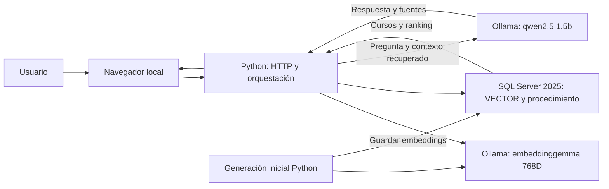

# Recomendador de cursos por intereses

Miniproyecto de preparación para DP-800, **nivel 3 avanzado: búsqueda semántica y RAG local**. Recomienda cursos según una necesidad, nivel, duración y temática, y genera una explicación con un LLM usando los cursos recuperados como contexto. El catálogo contiene 131 cursos para probar.

## Inicio rápido desde cero

```powershell
gh repo clone cEgXOl/dp800-course-recommender
cd dp800-course-recommender
```

Requisitos: Windows 11, SQL Server 2025 local, SSMS 22 o VS Code con mssql, Git, Python 3.10+, ODBC Driver 18 y Ollama. No hacen falta recursos Azure ni una clave API. Los modelos se descargan una vez y la inferencia consume CPU/GPU y memoria del equipo.

En PowerShell, desde la carpeta descargada del repositorio:

```powershell
python -m venv .venv
.\.venv\Scripts\python.exe -m pip install -r requirements.txt
ollama pull embeddinggemma
ollama pull qwen2.5:1.5b
$env:COURSE_RECOMMENDER_SQL_CONNECTION_STRING = 'Driver={ODBC Driver 18 for SQL Server};Server=localhost\SQLEXPRESS;Database=CourseRecommender;Trusted_Connection=yes;Encrypt=yes;TrustServerCertificate=yes;'
.\.venv\Scripts\python.exe scripts\setup_database.py --security-tests
.\.venv\Scripts\python.exe scripts\generate_embeddings.py
.\.venv\Scripts\python.exe app.py
```

Abre http://127.0.0.1:8000. Ollama y SQL Server deben estar iniciados. El usuario de Windows necesita crear/alterar la base y sus objetos durante la instalación y poder impersonar `CourseReaderDemo` al ejecutar la demostración. La aplicación ejecuta sus lecturas bajo ese usuario sin login y revierte la identidad al cerrar cada conexión. Es una demostración local de permisos; un despliegue real utilizaría una cuenta de servicio dedicada con los permisos del rol lector, sin capacidad de impersonación administrativa.

## Arquitectura



SQL Server almacena el catálogo y calcula la distancia. Python comunica con los dos modelos locales. En búsqueda se devuelve el ranking; en RAG se añade una respuesta generada a partir de los cuatro primeros cursos. Sin fuentes se devuelve una abstención sin invocar el LLM.

## Estructura

- `sql/01_schema.sql`: crea de forma repetible las tablas y restricciones del catálogo.
- `sql/00_create_database.sql`: crea la base si no existe, para ejecución manual en master.
- `sql/07_programmability.sql`: vistas y procedimiento de recomendación optimizado.
- `sql/08_security.sql` y `sql/09_security_tests.sql`: roles, permisos y pruebas de acceso.
- `sql/10_benchmark_baseline.sql`: procedimiento inicial de referencia para el benchmark.
- `rag.py`: generación RAG, contexto y validación de citas.
- `scripts/setup_database.py`: instala el catálogo y los objetos SQL sin eliminar datos.
- `scripts/validate_project.py`: pruebas unitarias y de integración con evidencias JSON.
- `scripts/benchmark.py`: comparación controlada de consultas con treinta ejecuciones pareadas.
- `scripts/reproduce.py`: reproducción en la base separada `CourseRecommender_Repro`.
- `sql/02_seed_catalog.sql`: carga de forma repetible un catálogo de cursos y temáticas de prueba.
- `sql/03_add_embedding_storage.sql`: añade a `dbo.Courses` el vector y los campos de trazabilidad para la fase 3.
- `sql/04_query_store_baseline.sql`: consulta el estado de Query Store y resume métricas de la búsqueda semántica.
- `sql/05_query_store_plan.sql`: muestra el XML y un resumen de operadores del plan capturado.
- `sql/06_expand_catalog_scale_test.sql`: añade 100 cursos sintéticos etiquetados para una prueba de escala moderada.
- `scripts/validate_catalog_scale.py`: muestra el tamaño del catálogo y ejecuta las siete búsquedas de validación.
- `scripts/generate_embeddings.py`: genera embeddings locales con Ollama y los guarda en SQL Server.
- `app.py` y `web/index.html`: servidor local y pequeña interfaz web del recomendador.
- `scripts/run_app.ps1`: inicia la interfaz con la conexión integrada de `localhost\SQLEXPRESS` y la base `CourseRecommender` por defecto.
- `docs/resultados-pruebas.md`: recoge las siete pruebas funcionales y el resultado validado.
- `docs/linea-base-query-store.md`: documenta las primeras métricas de rendimiento registradas.
- `docs/estado-proyecto.md`: resume las seis fases, las decisiones y cómo realizar la demostración.

## Modelo inicial

- `dbo.Courses`: catálogo de cursos, con nivel, duración en minutos, descripción y atributos opcionales en JSON.
- `dbo.Categories`: temáticas del catálogo.
- `dbo.CourseCategories`: relación muchos-a-muchos entre cursos y temáticas.

La columna vectorial no forma parte del esquema inicial. Para evitar llamadas de pago a una API, la decisión actual es generar embeddings en local con Ollama y el modelo `embeddinggemma` de 768 dimensiones.

## Ejecutar en VS Code

1. Abre esta carpeta en Visual Studio Code e instala/configura la extensión **SQL Server (mssql)** con una conexión a una instancia de SQL Server 2025.
2. Abre `sql/01_schema.sql`, selecciona la base de datos destino en la conexión y ejecuta el script.
3. Ejecuta `sql/02_seed_catalog.sql` para cargar los datos de prueba y revisar los resultados de control al final del script.

El script de esquema crea tablas, claves y restricciones; no configura servicios externos.

## Fase 2: catálogo de prueba

Después de ejecutar `sql/01_schema.sql`, ejecuta `sql/02_seed_catalog.sql` en la misma base de datos. En un catálogo vacío añade 31 cursos y 10 temáticas, con niveles y duraciones variados, enlaces a las temáticas y atributos JSON de competencias/prerrequisitos. Incluye casos de SQL/T-SQL, análisis, Power BI, administración, Azure, ingeniería de datos, Python y búsqueda semántica. La carga omite títulos y categorías ya presentes y no modifica filas existentes. Al final muestra recuentos y consultas para detectar títulos duplicados, campos vacíos y cursos sin temática.

## Fase 3: embeddings locales

Tras crear la tabla y cargar el catálogo:

1. Instala [Ollama](https://ollama.com/download) y comprueba que esté iniciado. EmbeddingGemma requiere Ollama 0.11.10 o posterior.
2. Descarga el modelo local: `ollama pull embeddinggemma` (aprox. 621 MB).
3. Ejecuta `sql/03_add_embedding_storage.sql` en la base de datos. Añade `VECTOR(768)` y campos para registrar el modelo y la fecha de generación.
4. Instala Python 3.10 o posterior y Microsoft ODBC Driver 18 for SQL Server. Crea el entorno e instala la dependencia: `python -m venv .venv` y `.\.venv\Scripts\python.exe -m pip install -r requirements.txt`.
5. Define `COURSE_RECOMMENDER_SQL_CONNECTION_STRING` con una conexión a esa base de datos. Ejemplo PowerShell para autenticación integrada: `$env:COURSE_RECOMMENDER_SQL_CONNECTION_STRING = 'Driver={ODBC Driver 18 for SQL Server};Server=localhost;Database=CourseRecommender;Trusted_Connection=yes;Encrypt=yes;TrustServerCertificate=yes;'`. Sustituye servidor y base de datos según tu instalación.
6. Ejecuta `.\.venv\Scripts\python.exe scripts\generate_embeddings.py`. El programa envía los textos a Ollama en `localhost`, usando el formato de documento `title: ... | text: ...`, valida que cada vector tenga 768 dimensiones y actualiza solo los cursos sin embedding. En la futura búsqueda, la petición del usuario debe llevar el prefijo `task: search result | query: ...` para usar el formato de recuperación recomendado por EmbeddingGemma.

La generación no consume tokens facturables ni llama a Azure OpenAI; usa memoria y capacidad de CPU/GPU del equipo. La imagen del modelo ocupa aproximadamente 621 MB. Si Ollama o SQL Server no están disponibles, el programa informa del error y revierte la transacción.

## Interfaz local

Con Ollama iniciado, SQL Server encendido y los embeddings generados, abre PowerShell en la carpeta del proyecto. Si la variable de conexión no está definida en esa sesión, asígnala y ejecuta la aplicación directamente con Python:

```powershell
$env:COURSE_RECOMMENDER_SQL_CONNECTION_STRING = 'Driver={ODBC Driver 18 for SQL Server};Server=localhost\SQLEXPRESS;Database=CourseRecommender;Trusted_Connection=yes;Encrypt=yes;TrustServerCertificate=yes;'
.\.venv\Scripts\python.exe app.py
```

Después abre <http://127.0.0.1:8000>. La página permite describir qué se quiere aprender y aplicar filtros opcionales. Tanto el vector de consulta como los vectores de los cursos se calculan con el mismo modelo local `embeddinggemma`; SQL Server los compara con `VECTOR_DISTANCE` y devuelve hasta diez cursos próximos. Se omiten los que superen una distancia coseno de 0,70 para evitar recomendaciones sin afinidad. Es un umbral inicial que se debe revisar al ampliar las pruebas y el catálogo. Para detener el servidor, vuelve a PowerShell y pulsa `Ctrl+C`.

Si tu instancia o base de datos tienen otro nombre, define `COURSE_RECOMMENDER_SQL_CONNECTION_STRING` en esa sesión de PowerShell antes de ejecutar el lanzador. La aplicación solo escucha en `127.0.0.1` y no expone la interfaz a la red.

## Fase 5: medición inicial con Query Store

Query Store identifica las sentencias por `object_id` de `dbo.usp_RecommendCourses`, evitando contar los propios diagnósticos. Ejecuta `sql/04_query_store_baseline.sql` para leer duración, CPU y lecturas por sentencia y plan. Si está desactivado, habilítalo con el comando mostrado y realiza búsquedas. `sql/05_query_store_plan.sql` devuelve el plan y sus operadores estimados. Una llamada al procedimiento puede ejecutar más de una sentencia; el benchmark suma sus métricas y divide por el número de llamadas, no por las ejecuciones internas.

### Ampliación opcional del catálogo

Para comparar el comportamiento con más filas, ejecuta `sql/06_expand_catalog_scale_test.sql`. Añade 100 cursos sintéticos (31 existentes + 100 nuevos = 131 al ejecutarlo por primera vez) y los relaciona con las diez categorías existentes. Los registros quedan identificados con `AdditionalAttributes.source = synthetic_scale_test`; el script se puede volver a ejecutar sin duplicar cursos. Después genera sus embeddings locales con `.\.venv\Scripts\python.exe scripts\generate_embeddings.py` y ejecuta `.\.venv\Scripts\python.exe scripts\validate_catalog_scale.py` para revisar el tamaño y repetir las siete búsquedas. Los embeddings se calculan en Ollama y no consumen tokens de Azure OpenAI.

## Funcionalidades DP-800

| Bloque | Implementación |
|---|---|
| A: diseño y programación | Tablas, PK/FK/CHECK/UNIQUE, índices de restricciones, vistas, procedimientos, CTE, JSON y ROW_NUMBER. |
| B: asistencia de IA | Trazabilidad de prompts, decisiones, correcciones y pruebas en `docs/asistencia-ia.md`. |
| C: seguridad | Roles/usuarios sin login, GRANT/DENY, mínimo privilegio y pruebas con EXECUTE AS/REVERT. |
| D: optimización | TOP K antes de agregar categorías; comparación controlada con resultados idénticos. |
| E: embeddings | embeddinggemma local, Title + Description + skills/prerequisites, VECTOR(768), modelo y fecha. |
| F: Intelligent Search | Distancia coseno, filtros relacionales y ranking. |
| G: RAG | Recuperación SQL, contexto visible, LLM local, respuesta con fuentes y abstención. |

## IA y justificación de la búsqueda

La distancia coseno `1 - (u·v)/(|u||v|)` compara la orientación de los embeddings y ordena textos por afinidad semántica; menor distancia indica mayor similitud. Se usa el mismo espacio vectorial para documentos y preguntas. La búsqueda es exacta sobre el catálogo y no necesita un índice vectorial aproximado para 131 cursos. El umbral 0,70 es empírico: se probó con consultas positivas y una negativa, sin pretender que sea universal.

`embeddinggemma` genera vectores; `qwen2.5:1.5b` genera texto. En RAG se envían la pregunta y los cuatro cursos recuperados a `/api/chat` con salida JSON estructurada. Se rechazan identificadores fuera del contexto y la aplicación añade las citas. Si no hay cursos o se pregunta explícitamente por precios (campo ausente del esquema), se informa de la ausencia de datos. Las citas validan identidad, no garantizan por sí solas que toda afirmación generada sea verdadera; debe revisarse la explicación.

Fuentes técnicas: [EmbeddingGemma](https://ollama.com/library/embeddinggemma), [Qwen2.5 1.5b](https://ollama.com/library/qwen2.5:1.5b), [chat local](https://docs.ollama.com/api/chat) y [salida estructurada](https://docs.ollama.com/capabilities/structured-outputs).

## Ejemplos y evidencias

- `Quiero aprender a analizar ventas con SQL y tengo conocimientos básicos`: el primer resultado de la validación inicial fue Fundamentos de SQL para análisis de ventas, distancia 0,2883.
- `Necesito convertir cifras comerciales en un tablero interactivo con gráficos`: caso de paráfrasis para comprobar recuperación más allá de una búsqueda literal de título.
- `Quiero aprender diseño de moda`: sin cursos pertinentes; se abstiene también en RAG.
- `Qué precio tienen los cursos para analizar ventas con SQL?`: se informa de que el catálogo no tiene precios.

Las solicitudes, cursos recuperados, contexto, respuestas y pruebas de acceso se guardan en `docs/evidence/validation.json`. Los modelos pequeños pueden producir respuestas distintas tras cambiar versión/configuración; las pruebas comprueban fuentes y filtros, no una frase fija.

## Pruebas y comparación de rendimiento

```powershell
.\.venv\Scripts\python.exe scripts\validate_project.py
.\.venv\Scripts\python.exe scripts\benchmark.py
.\.venv\Scripts\python.exe scripts\reproduce.py
```

El benchmark utiliza el mismo catálogo, vector y filtros, tres calentamientos y treinta llamadas pareadas alternando orden. Se excluye la generación de embeddings. Se comparan las filas completas y se toman deltas de Query Store por procedimiento. Las cifras de la sesión local del 26/10/2026 fueron:

| Métrica por llamada | Consulta inicial | CTE TOP K antes de categorías |
|---|---:|---:|
| Duración SQL media | 1,475 ms | 1,164 ms |
| CPU SQL media | 1,256 ms | 0,899 ms |
| Lecturas lógicas | 1.145 | 331 |
| Mediana cliente/ODBC | 2,641 ms | 2,616 ms |

La reducción de lecturas es aproximadamente del 71 %. La diferencia de latencia cliente es pequeña y sensible al ruido en este catálogo; no se extrapola a miles de cursos. La primera variante con tabla temporal reducía lecturas pero aumentaba duración y se descartó. Evidencias y planes: `docs/evidence/optimization.json` y `optimization-materialized-trial.json`.

## Conclusiones y límites

El proyecto demuestra cómo combinar restricciones relacionales, permisos y programación T-SQL con embeddings y un LLM local. Los problemas encontrados (conversión ODBC ntext/VECTOR, alias reservado, identificación de Query Store y citas inconsistentes) se documentan junto con sus correcciones. La optimización muestra por qué una reducción de lecturas no garantiza una mejora de latencia.

El catálogo es ficticio y el RAG puede cometer errores; no contiene precios, matrícula ni oferta formativa real. El modelo de embeddings y su dimensión deben cambiarse conjuntamente y obligan a regenerar vectores. Para producción se requerirían cuenta de servicio dedicada, gestión operativa y una evaluación de relevancia más amplia.

## Entrega y demostración

Entregables: [informe técnico PDF](output/pdf/informe-dp800.pdf), [PowerPoint editable](presentation/dp800-project.pptx), [guion de 5–8 minutos](docs/guion-presentacion.md) y [matriz final de cumplimiento](docs/cumplimiento-final.md). La auditoría inicial se conserva como historial y la comparación controlada está en [optimizacion-controlada.md](docs/optimizacion-controlada.md).

Para ejecutar el proyecto solo hace falta `requirements.txt`. La regeneración del PDF es opcional y usa `requirements-docs.txt`; el generador del PowerPoint usa el runtime de autoría de Codex. El PPTX entregado es editable directamente en PowerPoint, sin ese runtime.
